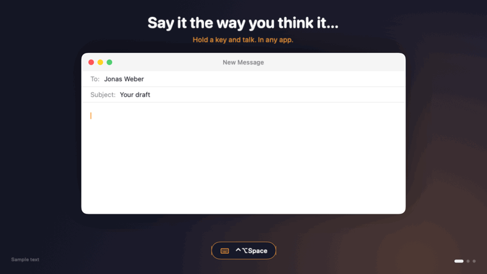

# Brain Input

**Talk. It types.** Hold a key, speak, and clean text lands at your cursor, formatted for the app you are in. Free and open source, for Apple Silicon Macs.



- **Dictation in any app.** An email comes out as an email, a chat message as a chat message, a prompt in your code editor with the file names spelled as on screen.
- **Speech recognition stays on your Mac.** Audio is never uploaded. It works offline and without an account.
- **Optional clean-up with Claude.** Add your own API key and filler words, false starts and "no wait, I mean…" disappear. Without a key you get the plain transcript.
- **It learns your words.** Correct a name twice and it is in your dictionary.
- **Meeting notes without a bot.** Records both sides of a call locally and writes a Me / Them transcript with summary, decisions and action items.
- **Your notes are files.** Plain Markdown in `~/BrainInput/`, searchable from the app, a CLI and an MCP server for Claude or Cursor.

This is a hobby project, built in a few weekend hours with Claude Fable doing most of the typing. It is a beta: expect rough edges, and please [tell me what breaks](https://github.com/elpresidentex/brain-input/issues).

## Install

1. Download the latest `BrainInput-x.y.z.dmg` from [Releases](https://github.com/elpresidentex/brain-input/releases/latest).
2. Open it and drag **Brain Input** to Applications.
3. Start it. The setup guide downloads a speech model (about 460 MB), asks for the two permissions it needs and lets you try a first dictation.

Requirements: a Mac with Apple Silicon and macOS 26 or newer. About 1 GB of free disk space.

## Use

| | |
|---|---|
| Dictate | hold `⌃⌥Space`, speak, release (a short tap starts and stops instead; `Esc` cancels) |
| Swap the last dictation for the raw transcript | `⌃⌥Z` |
| Record a meeting | accept the offer that appears when a call starts, or menu bar › Record a Meeting… |
| Everything else | menu bar icon › Open Brain Input… |

Both shortcuts can be changed in Settings, also to a single modifier key such as the right `⌘`.

## Privacy and cost

- Audio is processed on your Mac and never stored or sent anywhere. Meeting audio is not written to disk; only text is kept.
- The app has no account and no profile of you. It sends one anonymous "opened" count at start (app and macOS version, no ID); switch it off in Settings.
- Network use: the one-time model download (from Hugging Face), and, only if you add a Claude API key, the clean-up calls to Anthropic. Those contain the transcript, the app name and window title, your dictionary and style notes; in coding apps also text visible in the window, so names are spelled right.
- Clean-up runs on your own Anthropic account. A dictation costs a fraction of a cent; Settings shows what the app has spent.
- Recording a call without telling the other people is illegal in many places, Germany included. The app reminds you every time; please do tell them.

Full text: [privacy page](https://brain-input.vercel.app/privacy.html).

## CLI and MCP

The app bundle contains `brain` (`/Applications/Brain Input.app/Contents/MacOS/brain`):

```bash
brain search "launch date"       # full-text search, --kind meeting|dictation, --json
brain last-meeting
brain history 5
brain models                     # speech models and whether they are installed
brain mcp                        # MCP server over stdio (read-only: search_notes, read_note, list_meetings, last_meeting, recent_dictations)
```

Claude Code: `claude mcp add brain-input -- "/Applications/Brain Input.app/Contents/MacOS/brain" mcp`

## Build from source

```bash
brew install cmake
scripts/fetch-whisper.sh     # builds whisper.xcframework from whisper.cpp, once
scripts/build-app.sh         # release build in build/BrainInput.app
swift test                   # 33 tests; no paid API calls, no permissions needed
```

Needs the Xcode 26 toolchain. `scripts/release.sh` makes the signed and notarized DMG. Design notes are in [`dev-notes/decisions.md`](dev-notes/decisions.md); the brief the first version was built from is in [`dev-notes/original-brief.md`](dev-notes/original-brief.md).

## Credits and licence

GPL-3.0, see [`LICENSE`](LICENSE). No warranty.

- The whisper integration and the paste-at-cursor code are adapted from [VoiceInk](https://github.com/Beingpax/VoiceInk) (GPL-3.0). If you want a polished, supported dictation app, buy theirs.
- Speech recognition: [whisper.cpp](https://github.com/ggml-org/whisper.cpp) (MIT) and [FluidAudio](https://github.com/FluidInference/FluidAudio) (Apache-2.0) running NVIDIA Parakeet TDT v3 (CC-BY-4.0) and OpenAI Whisper large-v3 turbo (MIT).
- The feature set was inspired by [Monologue](https://www.monologue.to/). Brain Input is not affiliated with it, with VoiceInk or with Anthropic.

Details: [`THIRD_PARTY_NOTICES.md`](THIRD_PARTY_NOTICES.md).
